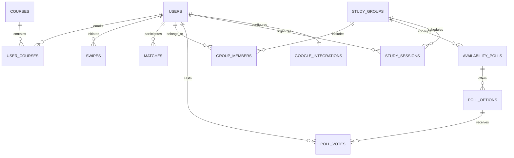
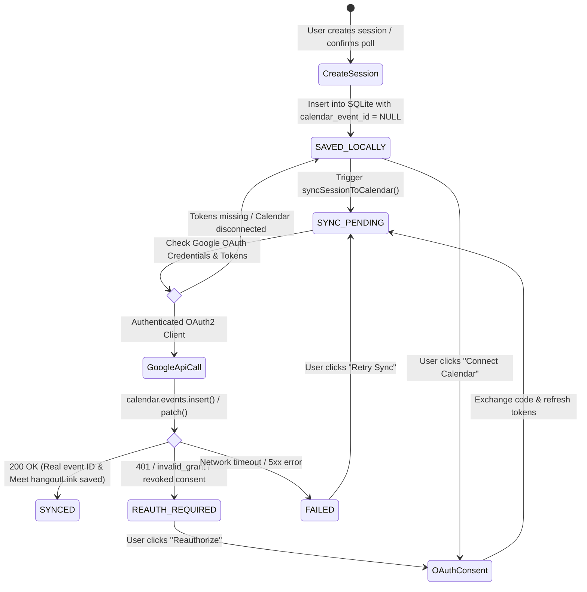

# StudyBuddy — Complete System Architecture & Technical Dossier

## 1. Executive Summary & Product Vision
**StudyBuddy** is a production-grade student study-partner matching and collaborative group-formation platform that orchestrates **Google Workspace** services (Google Calendar, Google Meet, Google Chat, Google Drive, and Gmail).

Rather than rebuilding mature communication or storage tools, StudyBuddy acts as an **intelligent student discovery and academic coordination layer**:
- Students discover compatible study partners via a **Tinder-style swipe deck** with active candidate filtering and instant deck resets.
- Deterministic, multi-factor compatibility algorithms compute syllabus alignment and schedule synergy scores.
- Mutual right-swipes create verified partnerships with 1-click links to **Google Chat Spaces**, **Google Calendar** sessions, and **Google Meet** conference rooms.
- Cohort study squads run **Availability Polls** to automatically resolve consensus study sprint times.
- Real Google Calendar synchronization persists events to Google Calendar and creates authentic Google Meet links via the Google Calendar API.
- Offline and disconnected sessions are gracefully preserved in SQLite with honest, non-fabricated status badges (`Saved locally — Calendar not connected`).
- Context-aware **AI Copilot** generates peer quizzes, concept explanations, and study sprint roadmaps.
- Built-in developer **Database Inspector** provides direct read-only transparency into local SQLite storage.

---

## 2. Complete Technology Stack

### Frontend
- **Framework**: React 19 (`react: ^19.3.1`, `react-dom: ^19.3.1`)
- **Build Tool / Bundler**: Vite 8 (`vite: ^8.3.5`, `@vitejs/plugin-react: ^6.1.2`)
- **Icons**: Lucide React (`lucide-react: ^1.61.0`)
- **Animation / Feedback**: Canvas Confetti (`canvas-confetti: ^1.9.4`)
- **CSS Architecture**: Vanilla CSS with comprehensive Design System Tokens (*Academic Modern Workspace*).
- **Typography**: Google Fonts — **Plus Jakarta Sans** (headings, display typography) and **Inter** (interface body, metadata, data tables).

### Backend
- **Runtime**: Node.js (ES Modules, `type: module`)
- **Framework**: Express.js (`express: ^4.21.0`)
- **Middleware**: CORS (`cors: ^2.8.5`), Dotenv (`dotenv: ^16.4.5`)
- **Third-Party APIs**: Google APIs Client Library (`googleapis: ^144.0.0`)
- **Server Execution**: Native `node --watch src/server.js` on port `5000`

### Database
- **Engine**: SQLite 3 (Driver: `sqlite3: ^5.1.7`)
- **Database File**: `server/studybuddy.sqlite` (auto-initialized and seeded with baseline student cohort and SRM course catalogue)
- **Data Access Pattern**: Parameterized queries using async Promise wrappers (`run`, `get`, `all`).

---

## 3. Exhaustive Directory & File Map

```
stackathon/
│
├── .env                              # Root environment variables (Google OAuth, Port, Client URL)
├── .gitignore                        # Standard Git ignore rules for node_modules, dist, sqlite, env
├── .oxlintrc.json                    # Oxlint static analysis and linter configuration
├── FUNCTIONALITY_AUDIT.md            # Comprehensive QA functionality audit of all UI controls
├── GOOGLE_WORKSPACE_SETUP.md         # Google Cloud project, OAuth 2.0 & least-privilege setup guide
├── IMPLEMENTATION_PLAN.md            # Architectural milestone and implementation plan
├── PROMPT_LOG.md                     # Chronological development prompt history with metadata and results
├── README.md                         # Project quickstart, architecture overview, and onboarding guide
├── SYSTEM_DOSSIER.md                 # Complete system architecture and technical dossier (this document)
├── index.html                        # HTML entry point with Plus Jakarta Sans & Inter font imports
├── package.json                      # Frontend dependencies (React 19, Vite 8, Lucide React, Confetti)
├── package-lock.json                 # Locked dependency tree for frontend
├── vite.config.js                    # Vite configuration with React plugin
│
├── public/                           # Static public web assets
│   └── favicon.svg                   # Application browser favicon
│
├── dist/                             # Compiled production bundle from `npm run build`
│   ├── index.html                    # Minified production HTML entry point
│   └── assets/                       # Bundled and chunked JavaScript & CSS assets
│       ├── index-*.js                # Compiled frontend bundle
│       └── index-*.css               # Bundled stylesheet
│
├── src/                              # Frontend React Source Code
│   ├── main.jsx                      # React DOM root render mount point
│   ├── App.jsx                       # Central state orchestrator, tab routing & global API dispatch
│   ├── App.css                       # Component-level styling overrides
│   ├── index.css                     # Global design tokens, themes, utilities & responsive sidebar CSS
│   │
│   ├── components/                   # Frontend UI View Components
│   │   ├── LoginPage.jsx             # Dedicated dark-mode Google OAuth 2.0 login view with glassmorphism & floating orbs
│   │   ├── Sidebar.jsx               # Fixed 260px left sidebar with badges, branding, profile pill & sign-out
│   │   ├── Navbar.jsx                # Horizontal header navigation (available fallback layout)
│   │   ├── DiscoveryView.jsx         # Swipe deck, course filters, Refresh, Reset Deck, explainability & confetti
│   │   ├── MatchesView.jsx           # Verified mutual matches, Chat triggers, schedule prompts, unmatching
│   │   ├── GroupsView.jsx            # Study squads, member rosters, availability polling matrix & sync button
│   │   ├── SessionsView.jsx          # Google Calendar sessions, Meet links, schedule form, retry, cancel
│   │   ├── AiAssistantView.jsx       # Contextual AI copilot (Concept Explainer, Peer Quiz, Study Roadmap)
│   │   ├── IntegrationsView.jsx      # Google Workspace live authorization dashboard
│   │   ├── SettingsView.jsx          # Student profile editor & real profile photo uploader/remover
│   │   ├── DatabaseInspectorView.jsx # Developer SQLite database browser (tables, rows, pagination, search)
│   │   └── UserAvatar.jsx            # Universal avatar component (image display, initials fallback, banner/circle)
│   │
│   ├── services/                     # Centralized API Services
│   │   └── api.js                    # Frontend REST client with error handling connecting to backend
│   │
│   └── mockData/                     # Initial Reference & Prototype Data
│       └── studyBuddyData.js         # Reference schemas and mock candidate dataset
│
└── server/                           # Backend Express & SQLite Application
    ├── .env                          # Server environment variables (PORT, CLIENT_URL, Google OAuth keys)
    ├── .env.example                  # Environment template for server setup
    ├── package.json                  # Backend dependencies (express, sqlite3, cors, dotenv, googleapis, multer)
    ├── package-lock.json             # Locked dependency tree for backend
    ├── studybuddy.sqlite             # Primary SQLite database file
    ├── inspect-db.js                 # CLI diagnostic script to inspect table counts and schemas
    ├── check-sessions.js             # CLI diagnostic script to inspect study sessions and sync states
    │
    ├── uploads/                      # Persistent Local Storage for Uploaded Media
    │   └── avatars/                  # Saved user profile photo files (served at /uploads/avatars/...)
    │
    ├── data/                         # Static Catalogues & Raw Seed Data
    │   └── srm-course-catalogue.json # Official SRM course catalogue (63 courses, credits, conflicts)
    │
    ├── src/                          # Server Source Code
    │   ├── server.js                 # Express application & versioned REST API endpoints (/api/v1/...)
    │   ├── matching.js               # Explainable deterministic compatibility scoring engine
    │   │
    │   ├── services/                 # External Service Integrations
    │   │   └── googleCalendar.js     # Google Calendar API, OAuth 2.0 exchange, Meet conference creation, sync
    │   │
    │   └── database/                 # Database Layer
    │       └── db.js                 # SQLite connection, Promise wrappers (run, get, all), migrations & seeds
    │
    └── test/                         # Automated Server Test Suites
        ├── api-test.js               # End-to-end API test suite (20 automated integration tests)
        ├── calendar-sync-test.js     # Unit test suite for Google Calendar sync logic and error handling
        └── avatar-test.js            # Comprehensive profile photo suite (20 tests: upload, discover, auth, fallback)
```

---

## 4. Complete Database Schema (SQLite)

The SQLite database at [`server/studybuddy.sqlite`](file:///c:/Users/ABHAY%20R%20DASARATHY/Downloads/stackathon/server/studybuddy.sqlite) contains **11 tables** enforcing relational integrity with foreign keys:



### Table Definitions

#### 1. `users`
Student profiles, academic standing, and study preferences.
```sql
CREATE TABLE IF NOT EXISTS users (
  id TEXT PRIMARY KEY,
  name TEXT NOT NULL,
  university TEXT NOT NULL,
  degree TEXT NOT NULL,
  year TEXT NOT NULL,
  bio TEXT,
  courses TEXT,                     -- JSON array of course labels
  preferred_methods TEXT,           -- JSON array of study method tags
  study_goals TEXT,
  availability_note TEXT,
  avatar TEXT,                      -- Persistent photo reference (e.g., /uploads/avatars/... or Google profile photo)
  avatar_url TEXT,                  -- Backward-compatible alias synchronized with avatar
  created_at DATETIME DEFAULT CURRENT_TIMESTAMP
);
-- Migration: db.js verifies `avatar` column exists at startup, altering the table if missing,
-- and scrubs all mock/unsplash image URLs to enforce real student uploads or initials fallbacks.
```

#### 2. `courses`
Official course catalogue (seeded from SRM syllabus).
```sql
CREATE TABLE IF NOT EXISTS courses (
  id TEXT PRIMARY KEY,
  code TEXT NOT NULL,
  title TEXT NOT NULL,
  category TEXT NOT NULL,
  department TEXT,
  conflict_flag BOOLEAN DEFAULT 0,
  conflict_note TEXT,
  created_at DATETIME DEFAULT CURRENT_TIMESTAMP,
  UNIQUE(code, title)
);
CREATE INDEX IF NOT EXISTS idx_courses_code ON courses(code);
CREATE INDEX IF NOT EXISTS idx_courses_title ON courses(title);
```

#### 3. `user_courses`
Junction table linking students to enrolled courses.
```sql
CREATE TABLE IF NOT EXISTS user_courses (
  id TEXT PRIMARY KEY,
  user_id TEXT NOT NULL,
  course_id TEXT NOT NULL,
  created_at DATETIME DEFAULT CURRENT_TIMESTAMP,
  UNIQUE(user_id, course_id),
  FOREIGN KEY (user_id) REFERENCES users(id) ON DELETE CASCADE,
  FOREIGN KEY (course_id) REFERENCES courses(id) ON DELETE CASCADE
);
```

#### 4. `swipes`
Tracks directional discovery choices (`LIKE` / `PASS`).
```sql
CREATE TABLE IF NOT EXISTS swipes (
  id TEXT PRIMARY KEY,
  swiper_id TEXT NOT NULL,
  swiped_id TEXT NOT NULL,
  direction TEXT NOT NULL CHECK(direction IN ('LIKE', 'PASS')),
  created_at DATETIME DEFAULT CURRENT_TIMESTAMP,
  UNIQUE(swiper_id, swiped_id),
  FOREIGN KEY (swiper_id) REFERENCES users(id) ON DELETE CASCADE,
  FOREIGN KEY (swiped_id) REFERENCES users(id) ON DELETE CASCADE
);
```

#### 5. `matches`
Confirmed mutual connections formed when two students reciprocally `LIKE` each other.
```sql
CREATE TABLE IF NOT EXISTS matches (
  id TEXT PRIMARY KEY,
  user1_id TEXT NOT NULL,
  user2_id TEXT NOT NULL,
  compatibility_score INTEGER NOT NULL,
  chat_space_url TEXT,
  created_at DATETIME DEFAULT CURRENT_TIMESTAMP,
  UNIQUE(user1_id, user2_id),
  FOREIGN KEY (user1_id) REFERENCES users(id) ON DELETE CASCADE,
  FOREIGN KEY (user2_id) REFERENCES users(id) ON DELETE CASCADE
);
```

#### 6. `study_groups`
Collaborative study squads.
```sql
CREATE TABLE IF NOT EXISTS study_groups (
  id TEXT PRIMARY KEY,
  name TEXT NOT NULL,
  course_code TEXT NOT NULL,
  description TEXT,
  leader_id TEXT NOT NULL,
  chat_space_url TEXT,
  drive_folder_url TEXT,
  created_at DATETIME DEFAULT CURRENT_TIMESTAMP,
  FOREIGN KEY (leader_id) REFERENCES users(id) ON DELETE CASCADE
);
```

#### 7. `group_members`
Junction table linking students to study squads.
```sql
CREATE TABLE IF NOT EXISTS group_members (
  id TEXT PRIMARY KEY,
  group_id TEXT NOT NULL,
  user_id TEXT NOT NULL,
  role TEXT DEFAULT 'MEMBER',
  joined_at DATETIME DEFAULT CURRENT_TIMESTAMP,
  UNIQUE(group_id, user_id),
  FOREIGN KEY (group_id) REFERENCES study_groups(id) ON DELETE CASCADE,
  FOREIGN KEY (user_id) REFERENCES users(id) ON DELETE CASCADE
);
```

#### 8. `availability_polls`
Group meeting polls for scheduling consensus.
```sql
CREATE TABLE IF NOT EXISTS availability_polls (
  id TEXT PRIMARY KEY,
  group_id TEXT NOT NULL,
  title TEXT NOT NULL,
  deadline TEXT,
  status TEXT DEFAULT 'OPEN' CHECK(status IN ('OPEN', 'CONFIRMED', 'CLOSED')),
  created_at DATETIME DEFAULT CURRENT_TIMESTAMP,
  FOREIGN KEY (group_id) REFERENCES study_groups(id) ON DELETE CASCADE
);
```

#### 9. `poll_options`
Individual candidate meeting time slots for a poll.
```sql
CREATE TABLE IF NOT EXISTS poll_options (
  id TEXT PRIMARY KEY,
  poll_id TEXT NOT NULL,
  time_slot TEXT NOT NULL,
  is_recommended BOOLEAN DEFAULT 0,
  created_at DATETIME DEFAULT CURRENT_TIMESTAMP,
  FOREIGN KEY (poll_id) REFERENCES availability_polls(id) ON DELETE CASCADE
);
```

#### 10. `poll_votes`
Votes cast by squad members on poll options.
```sql
CREATE TABLE IF NOT EXISTS poll_votes (
  id TEXT PRIMARY KEY,
  poll_option_id TEXT NOT NULL,
  user_id TEXT NOT NULL,
  created_at DATETIME DEFAULT CURRENT_TIMESTAMP,
  UNIQUE(poll_option_id, user_id),
  FOREIGN KEY (poll_option_id) REFERENCES poll_options(id) ON DELETE CASCADE,
  FOREIGN KEY (user_id) REFERENCES users(id) ON DELETE CASCADE
);
```

#### 11. `study_sessions`
Scheduled study sessions with synchronization state.
```sql
CREATE TABLE IF NOT EXISTS study_sessions (
  id TEXT PRIMARY KEY,
  title TEXT NOT NULL,
  group_id TEXT,
  match_id TEXT,
  organizer_id TEXT NOT NULL,
  calendar_event_id TEXT,           -- Verified Google Calendar Event ID (NULL if unsynced)
  meet_url TEXT,                    -- Verified Google Meet URL (NULL if not generated)
  time_display TEXT NOT NULL,
  start_time DATETIME,
  end_time DATETIME,
  agenda TEXT,                      -- JSON array of agenda strings
  drive_notes_url TEXT,
  status TEXT DEFAULT 'SCHEDULED',
  sync_status TEXT DEFAULT 'SAVED_LOCALLY', -- SAVED_LOCALLY, SYNC_PENDING, SYNCED, FAILED, REAUTH_REQUIRED
  sync_error TEXT,
  last_synced_at DATETIME,
  created_at DATETIME DEFAULT CURRENT_TIMESTAMP,
  FOREIGN KEY (organizer_id) REFERENCES users(id) ON DELETE CASCADE
);
```

#### 12. `google_integrations`
Encrypted Google OAuth token storage and integration status per user.
```sql
CREATE TABLE IF NOT EXISTS google_integrations (
  user_id TEXT PRIMARY KEY,
  access_token TEXT,
  refresh_token TEXT,
  google_email TEXT,
  calendar_connected BOOLEAN DEFAULT 0,
  drive_connected BOOLEAN DEFAULT 0,
  chat_connected BOOLEAN DEFAULT 0,
  gmail_connected BOOLEAN DEFAULT 0,
  updated_at DATETIME DEFAULT CURRENT_TIMESTAMP,
  FOREIGN KEY (user_id) REFERENCES users(id) ON DELETE CASCADE
);
```

---

## 5. Google Calendar Synchronization Architecture

### Synchronization Lifecycle & State Machine



### Exact Status States & UI Rendering
1. **`SYNCED`** ("Synced to Google Calendar"):
   - Indicates Google Calendar API confirmed event creation.
   - Real `calendar_event_id` is displayed (`Google Event: <id>`).
   - Authentic Google Meet link is active with 1-click launch and clipboard copy.
2. **`SAVED_LOCALLY`** ("Saved locally — Calendar not connected"):
   - Indicates session is persisted in SQLite, but Google Calendar is disconnected.
   - Displays `Local ID: sess-...` (never fabricates fake event IDs).
   - Meet button shows `No Meet Link (Sync with Google to generate)`.
   - Offers `Connect Calendar` button directly on the session card.
3. **`SYNC_PENDING`** ("Synchronization pending"):
   - Set during in-flight synchronization requests with spinner animation.
4. **`FAILED`** ("Synchronization failed"):
   - Retains local session in SQLite and records recoverable error message.
   - Offers `Retry Sync` action button.
5. **`REAUTH_REQUIRED`** ("Reauthorization required"):
   - Triggered when refresh token expires or consent is revoked.
   - Offers `Reauthorize` action button directing user to Google OAuth consent.

### Idempotency & Duplicate Prevention
When retrying synchronization:
- If `calendar_event_id` exists and is a real Google event ID, `googleCalendar.js` issues a `calendar.events.patch` call instead of `insert`.
- This updates the existing Google Calendar event and **never creates duplicate events**.
- If the event was deleted externally on Google Calendar (404/410), it recreates the event cleanly and saves the new Google event ID.

---

## 6. Complete REST API Endpoint Reference

All endpoints are versioned under `/api/v1` and return JSON.

### Health Check
- `GET /api/v1/health`: Returns API status and timestamp.

### Current User Profile & Avatar System
- `GET /api/v1/users/me`: Retrieves current authenticated user profile (with formatted `avatar` and `avatar_url`).
- `PUT /api/v1/users/me`: Updates bio, goals, study methods, and availability.
- `POST /api/v1/users/me/avatar` & `POST /api/v1/users/:userId/avatar`: Uploads and validates profile photo (`multipart/form-data`, file field `avatar`, allowed: JPG, JPEG, PNG, WebP; max size: 5 MB). Persists image to disk in `server/uploads/avatars/`, unlinks prior uploaded avatar file, saves URL in `users.avatar`, and returns updated user. Enforces `403 Forbidden` authorization if a user attempts to modify another student's avatar.
- `DELETE /api/v1/users/me/avatar` & `DELETE /api/v1/users/:userId/avatar`: Removes profile photo, securely deletes file from disk, sets `avatar = NULL` in database, and returns user. Enforces `403 Forbidden` if unauthorized.
- `GET /uploads/avatars/:filename`: Static route serving uploaded avatar media with appropriate cache headers.

### SRM Course Catalogue
- `GET /api/v1/courses`: Retrieves catalogue with `search` and `category` query filters.
- `GET /api/v1/users/me/courses`: Retrieves enrolled courses for current user.
- `POST /api/v1/users/me/courses`: Enrolls user in course (prevents duplicates with 400).
- `DELETE /api/v1/users/me/courses/:courseId`: Removes course from user profile.

### Candidate Discovery & Swipes
- `GET /api/v1/discovery/candidates`: Retrieves un-swiped candidates with compatibility scores.
- `POST /api/v1/swipes`: Records `LIKE` or `PASS`. If reciprocal `LIKE`, creates a match.
- `POST /api/v1/discovery/reset`: Resets discovery deck by clearing all swipes for user.

### Matches
- `GET /api/v1/matches`: Retrieves verified mutual matches.
- `DELETE /api/v1/matches/:id`: Safely unmatches, deleting mutual match and reciprocal swipes.

### Study Squads & Availability Polls
- `GET /api/v1/groups`: Lists study squads with member rosters and active polls.
- `POST /api/v1/groups`: Creates a new study squad.
- `GET /api/v1/groups/:groupId/polls`: Lists availability polls for a group.
- `POST /api/v1/groups/:groupId/polls`: Creates availability poll with candidate time slots.
- `POST /api/v1/polls/:pollId/vote`: Toggles a member's vote on a time slot option.
- `POST /api/v1/polls/:pollId/confirm`: Confirms winning consensus slot, marks poll `CONFIRMED`, creates study session, and initiates Google Calendar sync.

### Study Sessions & Synchronization
- `GET /api/v1/sessions`: Lists study sessions ordered by creation date.
- `POST /api/v1/sessions`: Creates study session, saves in SQLite, initiates Google Calendar sync.
- `POST /api/v1/sessions/:id/sync`: Retries Google Calendar sync for a session (idempotent).
- `DELETE /api/v1/sessions/:id`: Cancels session, deletes Google Calendar event if synced, removes from SQLite.

### Google Workspace & OAuth 2.0 (Sole Authentication Mechanism)
- `GET /api/v1/auth/me`: Verifies active session token state in `google_integrations`. Returns `{ user, google_email }` if authenticated, or `401 Unauthorized` if unauthenticated.
- `GET /api/v1/auth/google/url`: Generates Google OAuth 2.0 consent URL using `googleapis` with scopes: `openid`, `email`, `profile`, `calendar.events`, `drive.file`. Returns `{ url }`.
- `GET /api/v1/auth/google/callback`: Exchanges authorization code for tokens, saves `access_token` and `refresh_token` in `google_integrations` table in SQLite, upserts user in `users` table (`google_id = google subject`, `name`, `email`, `avatar_url`), redirects to `http://localhost:5173/?auth=success`.
- `POST /api/v1/auth/google/disconnect`: Revokes Google Workspace authorization, clears access/refresh tokens from `google_integrations`, and returns `{ success: true }`.
- `GET /api/v1/integrations`: Returns actual connection status for Google Workspace services.
- `POST /api/v1/integrations/toggle`: Toggles integration state (blocks enabling Calendar without real OAuth tokens).

### AI Copilot
- `POST /api/v1/ai/query`: Academic copilot generating explanations, quizzes, and sprint roadmaps based on course context.

### Developer Database Inspector
- `GET /api/v1/dev/database/overview`: Summarizes all 11 tables, row counts, and schema definitions.
- `GET /api/v1/dev/database/table/:tableName`: Paginated record browser with schema columns.

---

## 7. Deterministic Compatibility Scoring Algorithm

The matching engine in [`server/src/matching.js`](file:///c:/Users/ABHAY%20R%20DASARATHY/Downloads/stackathon/server/src/matching.js) calculates a score from `0` to `100`:

$$\text{Total Score} = \text{Syllabus} (40\%) + \text{Schedule} (30\%) + \text{Method} (20\%) + \text{Department} (10\%)$$

1. **Course & Syllabus Alignment (Max 40 points)**:
   - Evaluates intersection of enrolled courses:
   $$\text{Score} = \min\left(40, \, \frac{|\text{Shared Courses}|}{\max(1, |\text{User Courses}|)} \times 40\right)$$
2. **Weekly Schedule Overlap (Max 30 points)**:
   - Jaccard similarity across weekly time slots (Morning, Afternoon, Evening, Weekend).
3. **Preferred Study Methods (Max 20 points)**:
   - Overlap across learning styles (*Problem Solving*, *Concept Review*, *Flashcards*, *Mock Exams*).
4. **Academic Department Synergy (Max 10 points)**:
   - Same department / complementary degree program award.

Each candidate card displays an **Explainable Synergy Breakdown** showing the exact percentage contribution of each factor.

---

## 8. Verification & QA Test Suites

The codebase includes three automated test suites:

### 1. End-to-End API Test Suite
Execute via:
```bash
node server/test/api-test.js
```
Validates **20 test cases**:
- Health check responsiveness
- SRM Course Catalogue ingestion (63 courses)
- Code conflict notes (e.g. `21CSC303J`)
- Enrolling and removing user courses
- Preventing duplicate course enrollments (400)
- Group poll creation, voting, and vote withdrawal
- Confirming consensus poll slot into study session
- Preserving session locally with `sync_status = 'SAVED_LOCALLY'` and `calendar_event_id = NULL`
- Retrying sync on local session without fabricating IDs
- Cancelling and deleting sessions
- Swipes, mutual matches, unmatching, and reciprocal cleanup
- Live Google OAuth URL endpoint generation

### 2. Google Calendar Sync Unit Test Suite
Execute via:
```bash
node server/test/calendar-sync-test.js
```
Validates:
- OAuth2 client initialization from environment
- Auth URL structure, `prompt=consent`, and offline scopes
- Disconnected session handling in SQLite
- Safe handling of `deleteCalendarEvent()` for local-only events

### 3. Real User Profile Photo Test Suite
Execute via:
```bash
node server/test/avatar-test.js
```
Validates **20 test cases**:
- Valid image uploads (JPG, JPEG, PNG, WebP)
- 5 MB maximum file size enforcement (returns 400 on >5MB)
- MIME validation rejection of non-images (.txt / text returns 400)
- Verified disk persistence in `server/uploads/avatars/`
- SQLite database persistence of `/uploads/avatars/...` URL
- Cross-user Discover rendering (User B viewing User A's uploaded photo)
- Initials avatar fallback for users without uploaded photos (zero stock/placeholder photos)
- Authorization security (`403 Forbidden` when attempting to edit/delete another user's avatar)
- Safe avatar removal: unlinks disk file, sets `avatar = NULL` in database, and reverts Discover card to initials

---

## 9. Developer Setup & Execution Guide

### Prerequisites
- Node.js v18+ (verified on Node.js v24.13.0)
- npm v9+

### Execution Commands

1. **Install Dependencies**:
   ```bash
   # Root / Frontend
   npm install

   # Backend Server
   cd server
   npm install
   cd ..
   ```

2. **Configure Environment Variables**:
   Create [`.env`](file:///c:/Users/ABHAY%20R%20DASARATHY/Downloads/stackathon/.env) and [`server/.env`](file:///c:/Users/ABHAY%20R%20DASARATHY/Downloads/stackathon/server/.env):
   ```env
   PORT=5000
   CLIENT_URL=http://localhost:5173
   SESSION_SECRET=studybuddy_super_secure_session_secret_dev_3812307

   # Google OAuth 2.0 Credentials
   GOOGLE_CLIENT_ID=your_client_id.apps.googleusercontent.com
   GOOGLE_CLIENT_SECRET=your_client_secret
   GOOGLE_REDIRECT_URI=http://localhost:5000/api/v1/auth/google/callback
   GOOGLE_CALLBACK_URL=http://localhost:5000/api/v1/auth/google/callback

   DATABASE_URL=./studybuddy.sqlite
   ```

3. **Start Development Servers**:
   ```bash
   # Terminal 1 - Backend Server (Port 5000)
   cd server
   npm run dev

   # Terminal 2 - Frontend Vite Server (Port 5173)
   npm run dev
   ```

4. **Run Test Suites**:
   ```bash
   node server/test/api-test.js
   node server/test/calendar-sync-test.js
   node server/test/avatar-test.js
   ```

5. **Build for Production**:
   ```bash
   npm run build
   ```
